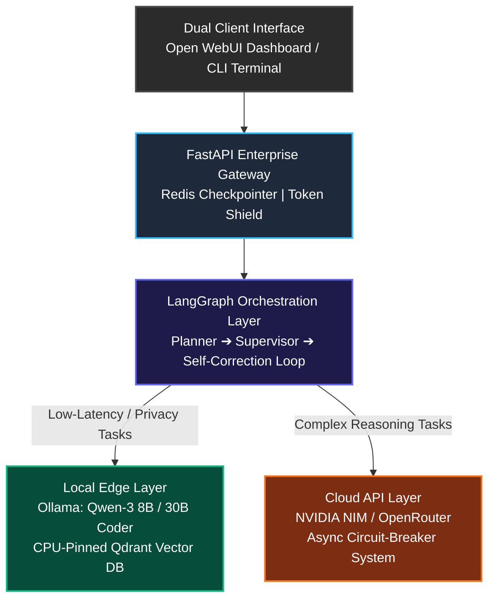

# TRAVIS: Hybrid AI Productivity Assistant & Autonomous Agent Platform


TRAVIS (**T**oken-Aware **R**outing and **A**gentic **V**irtual **I**nference **S**ystem) is a **hybrid AI agentic platform** engineered to optimize developer workloads dynamically across consumer edge hardware and enterprise cloud microservices. 

Most AI projects rely entirely on expensive cloud APIs or slow local configurations. TRAVIS solves this by acting as a **hardware-aware routing controller**, offloading complex engineering logic to cloud-scale infrastructure while reserving local edge processing for everyday low-latency tasks.

---

## 🏗️ System Architecture & Design



---

## 🚀 Key Engineering Implementations

### 1. Hardware-Aware Dual Routing Engine (Phase 1 Complete)
* **The Problem:** Local consumer hardware (Laptop with an Intel i7-12650H, RTX 3060 6GB VRAM, and 32GB RAM) suffers critical latency collapse when executing large-context generations concurrently with deep vector database embedding allocations.
* **The Solution:** Implemented a memory-isolated execution split. The **Qdrant Vector DB is pinned strictly to CPU/System RAM** inside Docker to protect consumer GPU memory. The system calculates active token weight and prompt complexity dynamically, routing routine debugging to local edge targets (`qwen3:8b` / `qwen3-coder:30b`) while automatically calling high-tier cloud APIs for dense multi-step reasoning.

### 2. Fault-Tolerant Multi-Agent Orchestration (Phase 1 Complete)
* **LangGraph Supervisor Pattern:** Configured a deterministic graph hierarchy. A *Planner Agent* structures incoming complex workflows into logical blocks. A *Supervisor Node* monitors token velocity and enforces a programmatic self-correction loop, validating generated code blocks inside sandboxed processes prior to compilation.
* **Asynchronous Resiliency Middleware:** Integrates structured `tenacity` catchers directly into cloud API pipelines. If external credits drop or trigger `429 (Rate Limit)` thresholds, the graph state gracefully shifts execution targets to local models down-stream without dropping conversational runtime persistence.

### 3. High-Scale Two-Stage Advanced RAG (Phase 2 In Development)
* **Hierarchical Ingestion & Parent-Child Chunking:** Standard flat chunking compromises surrounding domain context. TRAVIS splits uploaded documents (`.pdf`, `.ipynb`, `.docx`, `.txt`) into concise child chunks for high-accuracy mathematical vector matching, while maintaining physical links to expansive parent source chunks to preserve architectural scope during contextual injection.
* **Context-Validation Gate & Local Reranking:** Integrates a local cross-encoder (`bge-reranker-base`) node to score retrieved context relevance. If top matched scores drop below a strict alpha confidence metric, the engine flags a local context deficit and issues a fallback web search request via the Brave/Perplexity API to ground the pipeline.

### 4. Distributed State Sync & Token Shield (Phase 3 Planned)
* **Centralized API State Persistence:** Migrates ephemeral memory handlers to a dedicated **Redis cache infrastructure**. This design choice enables identical session streaming, context validation, and graph state updates across both the browser-based **Open WebUI** environment and the low-overhead terminal **CLI interface**.
* **Sliding Window Token Budget Guard:** Implements real-time token tracking via `tiktoken`. If lengthy multi-turn agent executions scale past 80% of local context windows, an auto-compaction pipeline condenses historical chat fragments without disrupting active system dependencies.

---

## 🛠️ Technical Stack & Keywords

* **LLM Orchestration:** LangGraph, LangChain, Ollama, NVIDIA NIM, OpenRouter API.
* **Vector Architecture & RAG:** Qdrant, HNSW Indexing, Vector Quantization (SQ), Cross-Encoder Rerankers, Unstructured Parsing, Hierarchical Chunking.
* **Backend Development:** FastAPI, Redis, Docker, Asyncio, Pydantic v2.
* **Evaluation Frameworks:** Ragas (Continuous monitoring of Faithfulness, Context Recall, and Answer Relevance).

---

## 📦 Local Installation & Core Setup

### 1. Clone Project and Setup Environment Variables
```bash
git clone https://github.com/linjunway/TRAVIS---AI-Productivity-Assistant.git
cd TRAVIS---AI-Productivity-Assistant
cp .env.example .env
```

### 2. Boot Independent Infrastructure Services via Docker
This initializes the isolated, CPU-bound Qdrant Vector store and the Redis operational checkpoint databases:
```bash
docker compose up --build
```

### 3. Synchronize Dependencies and Execute Target Client
Utilizes `uv` for modern, reliable package dependency synchronization:
```bash
# Sync packages exactly via lockfile
uv sync
source .venv/bin/activate

# Launch the system via the interactive Terminal CLI
python src/travis/main.py --interface cli
```